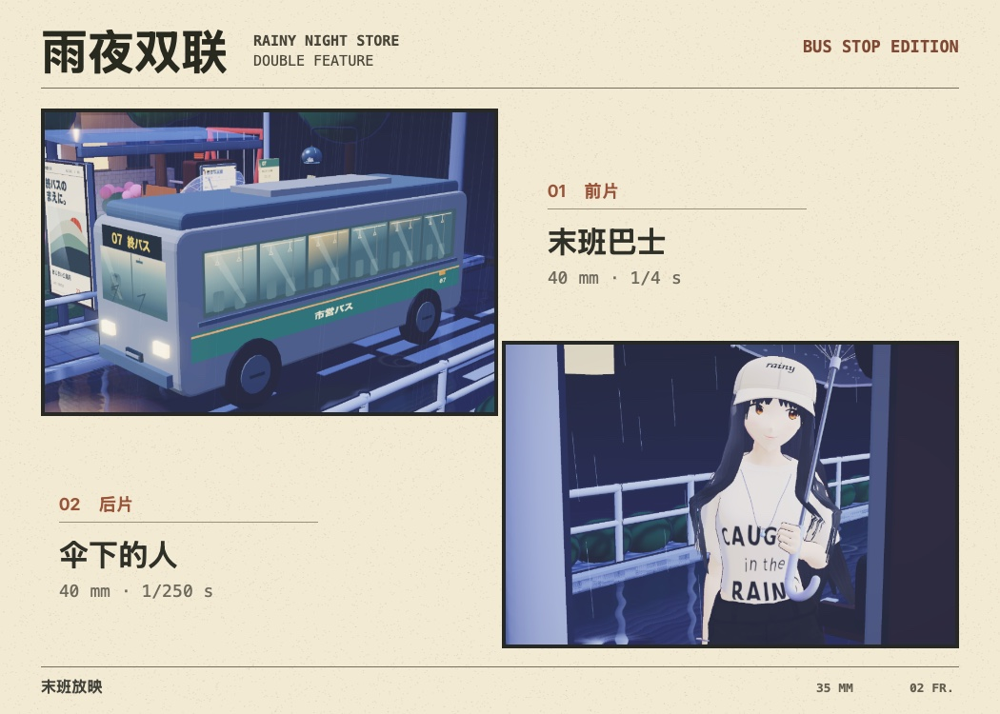
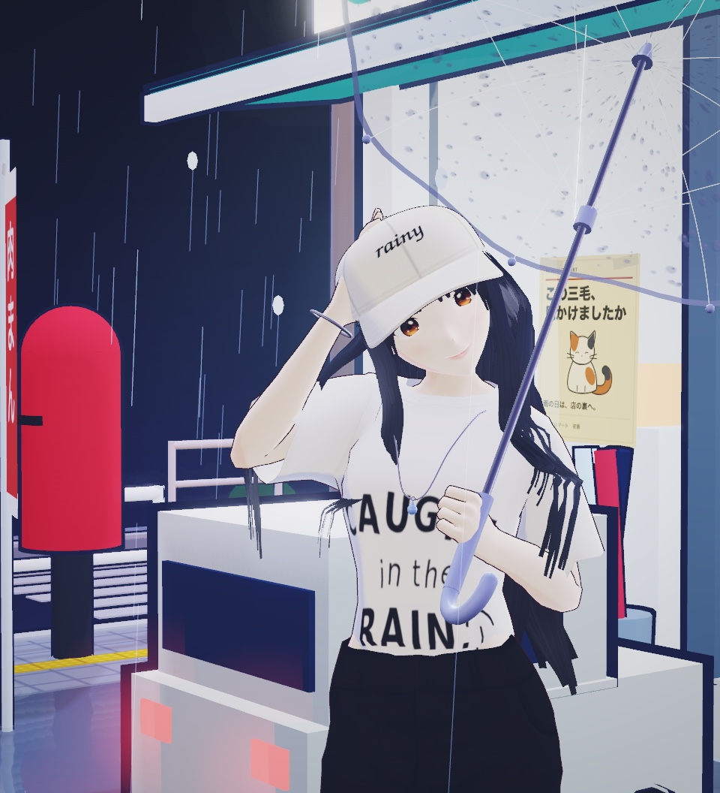

# 雨夜便利店 · 末班底片

下着雨，绣球公园的 07 路还会再来一趟。你可以跟原来的撑伞女孩一起散步，也可以去公交亭领一卷三格胶片。拍下的两格可以并成一张照片，挂在这条街自己的候车灯箱里。

本作从 fubuki106 的《雨夜便利店》原始导出版本继续制作。默认使用原版女孩：脸、身形、白帽、黑长直、衣服、透明伞，以及原来的待机、挥手和眨眼。按 **H** 可以单独试一下发丝柔光，收淡帽沿下的亮带。再按一次回到原版。Mac 菜单「画面」也可以选择，游戏会记住你的偏好。

## 在 Mac 上玩

解压后双击 **雨夜便利店·末班底片.app**。程序自带 3D 引擎、模型与贴图，可离线运行。macOS 13 或更新版本支持 Apple Silicon 和 Intel。[下载 Mac 版](https://raw.githubusercontent.com/fubuki106/rainy-night-store/feature/last-frame-at-the-bus-stop/macOS/RainyNight-macOS.zip)

用源码打包时，在本仓库运行 `bash macOS/build.sh`。桌面封装和验收命令在 [macOS/README.md](macOS/README.md)。

## 去公交亭

1. 按 **F**，女孩会沿着街道走到候车亭领取胶卷。你也可以自己走到冲印机前，点一下机器。
2. 在取景器里用 **‹ ›** 或左右方向键切换四个取景点。拖动改变构图，滚轮拉近。**L** 换焦段，**T** 在 1/250 秒与 1/4 秒慢门之间切换。按 **空格** 拍下真正的街景。**F** 收起相机继续走。
3. 至少拍两张后，点 **回站台冲印**。选两格，排先后，打开曝光灯，在标记区间关灯。曝光早了或晚了都能重试。
4. 把成片装进原公交亭的灯箱。走近细看，可以把双联相纸保存为 PNG。胶卷和这次装裱的相纸会在本机续存。

## 平时散步

- 在便利店橱窗前按 **E** 读寻猫启事，再按一次，可以沿雨里的脚印绕去后巷。走到三花身边按 **E**，女孩用原版动作挥手，三花会回头、侧耳。三花正吃饭时，她会在旁边等。猫回应后，橱窗和后巷的启事都会多一枚印章。
- 绣球公园木牌边有只玻璃风铃。按 **E** 轻拨纸签，留意铃沿落下的水滴；余音还没散时再拨一次，声音和摆动都会变。
- 站牌前按 **E** 可以空手等 07 路。女孩保持原来的待机动作和散步时的视角，可以自由绕到站牌另一侧看车进站。想拍照时再按 **F** 取胶卷。
- WASD / 方向键：走路；空格：挥手（近猫时打招呼）。上述三个地方也能直接点。移动、拖动视角或按 **Esc** 可以收回特写。
- 点击地面：走到目标位置；点击主角：互动。
- 拖动：旋转视角；滚轮 / 双指：缩放。
- 「近景 / 全景」切换视角；「后门」查看 NPC 所在后场。

[同帧对照：GitHub 原版 / 游戏默认 / 发丝柔光](macOS/original-character-compare.jpg) · [看 13 秒实机：原版黑长直与可选的发丝柔光](https://raw.githubusercontent.com/fubuki106/rainy-night-store/feature/last-frame-at-the-bus-stop/macOS/hair-study.mp4)

## 开发时预览

在项目目录运行 `python -m http.server 8000`，浏览器打开 `http://localhost:8000`。
解压完整目录后，也可以直接用浏览器打开 `index.html` 离线游玩。即使本地文件请求受浏览器限制，人物与贴图仍从随包脚本载入。若数据读取中断，游戏会自动重新载入，也可以点「重试载入」原地继续。

## 部署

无需构建或安装依赖。GitHub Pages 设置为从 `main` 分支的根目录发布即可。
所有 Three.js 脚本固定在 0.147.0 并随站点提供；模型、贴图同样使用相对路径，支持仓库子目录部署。

## 文件

- `index.html`：场景、交互和样式。
- `film/character-pack.js`：原始 GLB 的完整 Base64（与上游解码字节一致），含骨骼、18 段动作及离线可读的原贴图。
- `gtex/`：角色与 NPC 的原始 WebP 贴图。编辑贴图后，运行 `python3 macOS/verify-character-pack.py --refresh-textures` 同步离线包。
- `vendor/three/`：Three.js 及其 MIT 许可证。
- `film/`：07 路巴士、取景器、双联冲印、街角寻路及新增的街景细节。
- [创作提示词](创作提示词.txt)。

素材来源说明见 [CREDITS.md](CREDITS.md)。
